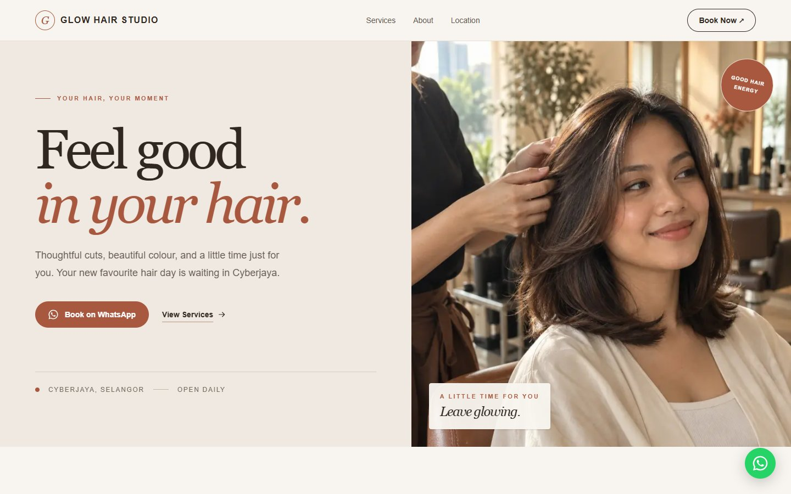
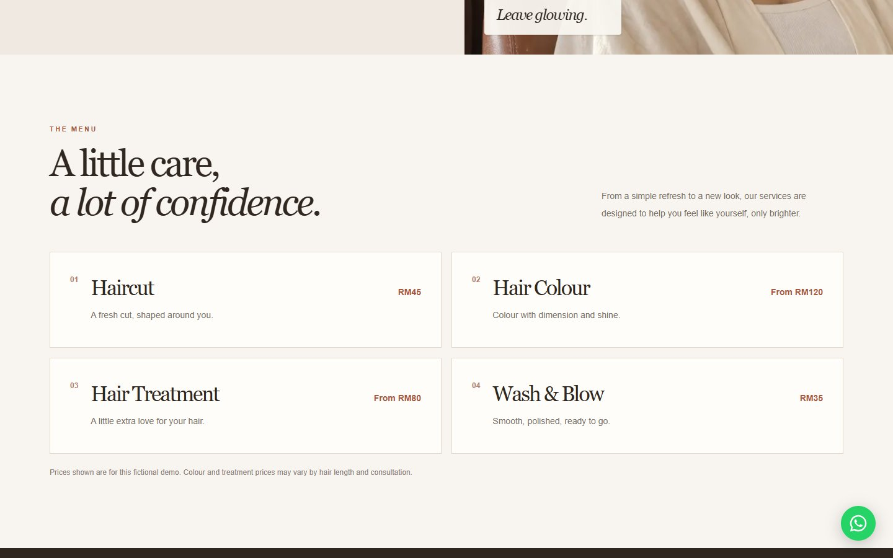
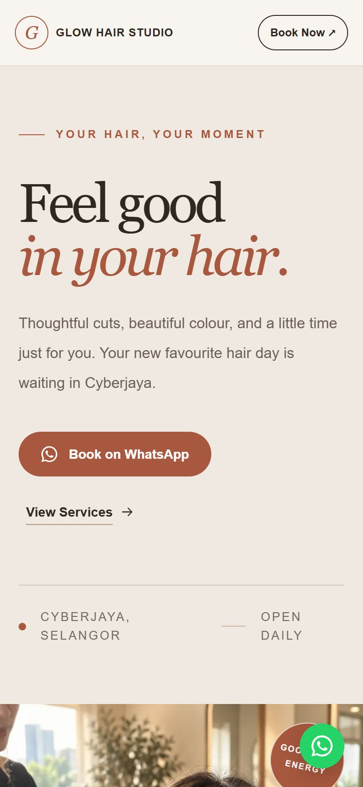

# Glow Hair Studio demo

A one-page website for a fictional hair salon in Cyberjaya, built with Next.js, TypeScript, and Tailwind CSS. Visitors book through WhatsApp. It needs no database, authentication, or paid API.

[Visit the live demo](https://glow-hair-studio.netlify.app/)

| Services on desktop | Homepage on mobile |
| --- | --- |
|  |  |

The business, reviews and photos are fictional. The booking buttons open WhatsApp with my own number, so test messages reach me.

## Run locally

1. Install [Node.js](https://nodejs.org/) (version 20 or newer).
2. Open a terminal in this folder and run `npm install`.
3. Run `npm run dev`.
4. Visit [http://localhost:3000](http://localhost:3000).

Use `npm run typecheck` to check TypeScript and `npm run build` to check the production build.

## Edit the demo

Edit `src/config/business.ts` for the business name, category, WhatsApp number and message, services and prices, opening hours, address, photos, and page wording. The `copy` section holds the headings and descriptions; `benefits`, `reviews`, and `faqs` hold the repeated content. **The number in that file is the demo owner's**; replace that one value before using real bookings. Use a Malaysian number with country code `60` and no `+`, spaces, or leading `0`.

To adapt this for a different business category, edit that one config file and replace the demo images. Review every section after changing the content: the one-page layout and warm visual style are still tailored to a service business, so some categories may need a separate design pass.

Replace the files in `public/images/` with your own images. Keep the filenames, or change the paths in `src/config/business.ts`. The supplied images are generated demo imagery and should be replaced for a real business.

Review the written content, FAQs, demo reviews, and SEO text before using this for a real salon. The reviews are explicitly marked fictional. The directions button opens a Google Maps search for the configured address, so add a full address for precise directions.

The demo has a `noindex` robots setting in `src/app/layout.tsx` so fictional business details do not appear in search results. Remove it for a real launch.

## Link preview and icon

`src/app/opengraph-image.jpg` is the card shown when the link is shared on LinkedIn, WhatsApp and other apps, and `src/app/icon.svg` is the browser-tab icon. Replace both for a different business. The full image URL comes from Netlify's `URL` setting at build time, so no environment variables need to be added.

## Deploy on Netlify

The live demo is hosted on Netlify from the `main` branch. To deploy your own copy, push this folder to a Git repository, import it at [netlify.com](https://www.netlify.com/), and keep the detected Next.js settings. The demo does not require environment variables.
